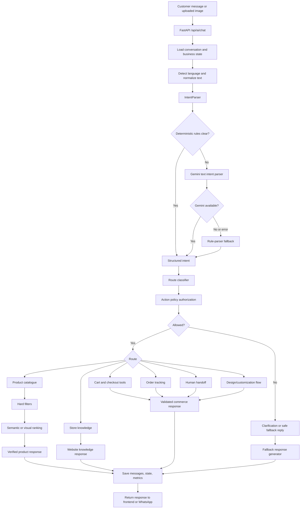
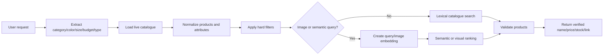

# AI Agent Workflow

This document explains how a customer message travels through the AI sales agent, where deterministic code is used, where Gemini/OpenAI are used, how product search works, and how fallback responses are selected.

## 1. Complete request flow



## 2. Entry points

| Channel | Entry point | Purpose |
|---|---|---|
| Web frontend | `POST /api/ai/chat` | Normal shopping chat, product search, image search, cart flow |
| WhatsApp | `/api/whatsapp/webhook` | Receives messages and sends the same agent responses through WhatsApp |
| Evaluation | `scripts/evaluate_agent_dataset.py` | Tests intent, route, entities, language, and safety behavior |

Main request orchestration is in `app/ai/sales_agent.py`.

## 3. What decides each step?

### A. Language and text normalization

File: `app/ai/language.py`

The agent detects:

- English
- Hindi script
- Telugu script
- Hinglish
- Roman Telugu

The parser also normalizes common spelling variations and mixed-language wording.

Example:

```text
ne dera ee t shirt unda
```

The word `unda` is a Roman Telugu signal. The request is handled as a Roman Telugu availability question, while `t-shirt` remains a product term.

### B. Intent extraction

File: `app/ai/intent_parser.py`

The parser extracts structured fields:

```json
{
  "intent": "product_search",
  "action": null,
  "category": "hoodie",
  "color": "black",
  "min_price": null,
  "max_price": 2000,
  "size": "XL",
  "attributes": {
    "catalog_type": "readymade"
  }
}
```

The parser first uses deterministic rules. Gemini is used only when the rules cannot safely understand the message or when the message is ambiguous.

### C. Route classification

File: `app/ai/tool_router.py`

The route classifier decides the capability required by the request. It does not itself execute actions.

Typical routes:

| Customer request | Route |
|---|---|
| “Show black hoodies” | `product_catalogue` |
| “Which one is best for a gift?” | Product recommendation behavior |
| “The second one” | Product selection behavior |
| “What sizes are available?” | Product details/catalogue |
| “Add it to my cart” | `cart` |
| “Yes, confirm” | `cart_confirmation` |
| “What is your return policy?” | `store_knowledge` |
| “Show hoodie designs” | `customization` / design library |
| “Connect me to support” | `human_handoff` |

### D. Action authorization

File: `app/ai/action_policy.py`

Before any state-changing operation, the policy checks the conversation state.

Examples:

- Cannot add to cart without a selected product.
- Cannot confirm without a pending quote.
- Cannot checkout without a selected product or active purchase.
- Cannot remove or update a cart item without an active cart item.

This prevents an AI guess from directly changing customer state.

## 4. Product-search workflow



### Hard filters happen first

File: `app/repositories/ecommerce_product_repository.py`

Products are removed before ranking when they do not match:

- Category
- Catalog type
- Price range
- Color
- Size
- Occasion
- Brand
- Excluded IDs
- Stock requirement

Similarity cannot make an invalid product eligible.

### Semantic search

Text semantic search uses:

- Gemini embedding model: configured by `GEMINI_EMBEDDING_MODEL`
- Product embeddings stored in `ai_product_search_index`
- Cosine similarity plus lexical overlap

### Image search

Image search uses:

1. Gemini or OpenAI vision analysis to identify the uploaded item.
2. Gemini image embedding when available.
3. Catalogue image/text/index attributes.
4. Hard filters.
5. Hybrid visual and metadata ranking.

If the image does not match a product strongly enough, the agent should say that the exact product was not found and offer similar products or customization.

## 5. Where AI models are used

### Gemini

File: `app/ai/gemini_client.py`

Used for:

- Ambiguous intent parsing
- Vision analysis of uploaded images
- Text embeddings
- Image embeddings
- Website/catalogue semantic understanding

The configured model is controlled by `GEMINI_MODEL`.

### OpenAI fallback

Also in `app/ai/gemini_client.py`.

OpenAI is used as a secondary provider when Gemini fails and an OpenAI key is configured. It is not the primary decision-maker when deterministic rules already resolve the request.

### No model is needed for

- Exact action detection such as `show cart` or `add it`
- Category aliases
- Sizes, colors, prices, and catalogue type extraction
- Hard product filters
- Cart authorization
- Checkout safety checks
- Product price/stock display
- Human-handoff detection

## 6. Conversation-state examples

### Search to selection

```text
User: Show black hoodies under 2000
State: category=hoodie, color=black, max_price=2000
Agent: Shows options 1–5

User: The second one
State: selected_product_id=option-2
Agent: Shows option 2 details
```

### Selection to size

```text
User: XL
State: selected/recommended product exists
Agent: Checks XL availability for that product
```

### Selection to cart

```text
User: Add it
State: selected product and valid size exist
Agent: Creates cart action

User: Yes, confirm
State: pending purchase quote exists
Agent: Confirms the cart action
```

### Image match found

```text
User: [uploads T-shirt image] Do you have this?
Agent: Finds a strong catalogue match and returns verified product facts.
```

### Image match not found

```text
User: [uploads image] Put this on a T-shirt
Agent: Does not claim the exact product exists. Routes to customization.
```

## 7. Fallback behavior

| Situation | Safe behavior |
|---|---|
| Gemini unavailable | Use deterministic parser and explicit clarification when needed |
| No product match | Say no exact match was found; offer similar/custom products |
| Low intent confidence | Ask a short clarification question |
| Missing product selection | Ask the customer to choose an option |
| Missing size | Ask for the size before cart action |
| No pending cart quote | Do not confirm; explain that confirmation is unavailable |
| Store policy question without knowledge | Say the policy could not be verified; offer human support |
| Unsupported request | Decline politely and return to shopping support |
| Human support request | Create or route a handoff instead of continuing normal shopping flow |

Fallback responses are generated through the sales-agent response paths and verified response helpers. Product facts should come from catalogue data, not from model memory.

## 8. Supported use cases

- Product discovery and filtering
- Product recommendations
- Product details, photos, links, price, stock, and sizes
- Uploaded-image product matching
- Custom logo, text, photo, and artwork products
- Design-library browsing
- Cart operations
- Checkout initiation
- Order tracking
- Store policy and delivery questions
- Human handoff
- English, Hindi, Telugu, Hinglish, and Roman Telugu conversations

## 9. Non-use cases and boundaries

The agent should not:

- Invent products, prices, stock, discounts, policies, or delivery dates.
- Add an unspecified product to a cart.
- Confirm a purchase without a pending quote.
- Treat a visually similar product as an exact match without sufficient confidence.
- Give medical, legal, or unrelated general advice.
- Claim an uploaded image is available as a ready-made product without catalogue evidence.
- Mix customization products into ordinary ready-made searches.
- Use semantic similarity to bypass explicit budget, category, size, or catalogue-type filters.

## 10. Main code map

| Responsibility | File |
|---|---|
| API request orchestration | `app/routes/ai.py`, `app/ai/sales_agent.py` |
| Language detection | `app/ai/language.py` |
| Intent and entity extraction | `app/ai/intent_parser.py` |
| Route classification | `app/ai/tool_router.py` |
| Action safety | `app/ai/action_policy.py` |
| Product search tools | `app/tools/product_tools.py` |
| Catalogue normalization/search | `app/repositories/ecommerce_product_repository.py` |
| Product embeddings | `app/services/catalog_indexer.py` |
| Website knowledge | `app/services/website_knowledge.py` |
| AI provider calls | `app/ai/gemini_client.py` |
| Response wording | `app/ai/response_generator.py`, `app/ai/sales_agent.py` |
| Conversation state | `app/services/conversation_flow.py` |
| Evaluation | `scripts/evaluate_agent_dataset.py`, `app/services/agent_evaluation.py` |

## 11. Recommended operational checks

Before production use:

1. Run catalogue reindexing after MongoDB is available:

   ```powershell
   cd C:\Users\Tejaswi\Documents\Full-Stack-Project\server\ai-agent-backend
   python scripts\reindex_catalog.py
   ```

2. Check catalogue health from the AI admin endpoints.
3. Check embedding counts and stale catalogue records.
4. Run route regression tests.
5. Run the 200-case evaluation with UTF-8 output.
6. Rotate any credentials that were previously stored in Helm values.
